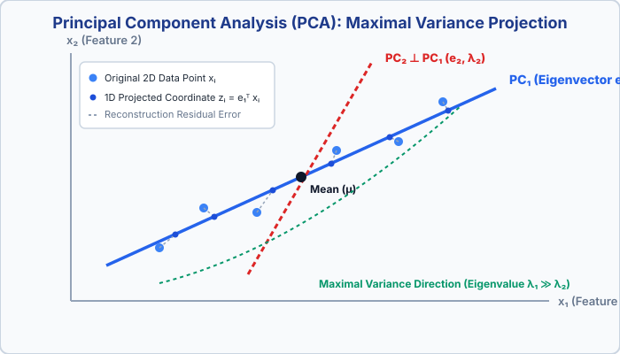

# MACSE504: Machine Learning - Module 4
# Comprehensive Study Notes: Dimensionality Reduction

<strong>Course:</strong> MACSE504 Machine Learning (ETH 1.0) | School of Computer Science and Engineering 
<strong>Prescribed Textbooks:</strong> 
1. A. Müller & S. Guido, <em>Introduction to Machine Learning with Python</em>, O'Reilly, 2016. 
2. P. Dangeti, <em>Statistics for Machine Learning</em>, Packt Publishing, 2017. 
3. T. Jo, <em>Machine Learning Foundations</em>, Springer Nature, 2021. 
<strong>VIT Exam Target:</strong> 10-Mark Detailed Answers for Principal Component Analysis (Covariance & SVD), Locally Linear Embedding (LLE), and t-SNE Crowding Resolution.

---

## 📺 Curated Video Lectures by Indian Professors (Under 20 Minutes)
* **CampusX (Nitish Singh) - PCA Mathematical Derivation & Eigenvectors (19:35 min):** [Watch on YouTube](https://www.youtube.com/watch?v=kuzJJgP_Kvw)  
  *Core Focus:* Covariance matrix derivation, Lagrange multiplier optimization for maximal variance.
* **Krish Naik - Principal Component Analysis (PCA) Step by Step (17:15 min):** [Watch on YouTube](https://www.youtube.com/watch?v=FgakZw6K1QQ)  
  *Core Focus:* Eigenvalue decomposition, projection matrix construction, scree plot.
* **CampusX - t-SNE Algorithm Intuition & Crowding Problem (18:50 min):** [Watch on YouTube](https://www.youtube.com/watch?v=NEaUSP4YerM)  
  *Core Focus:* High-dim Gaussian vs Low-dim Student-t distribution, perplexity tuning.

---

## 1. Motivation: The Curse of Dimensionality

  
  
Figure 4.1: Principal Component Analysis (PCA) maximal variance projection along eigenvector $e_1$.

In high-dimensional spaces $\mathbb{R}^d$:
1. **Exponential Volume Growth:** The volume of a hypercube scales as $L^d$. Data points become exponentially sparse, requiring exponentially many samples to maintain representative density.
2. **Distance Equidistance:** The ratio of distances between the nearest and farthest neighbor converges to 1:
   $$\lim_{d \to \infty} \frac{\text{dist}_{\max} - \text{dist}_{\min}}{\text{dist}_{\min}} \to 0$$
   Rendering distance-based algorithms (KNN, K-Means) ineffective without dimensionality reduction.

---

## 2. Principal Component Analysis (PCA)

PCA is an unsupervised, linear technique that projects data onto an orthogonal basis that maximizes sample variance (or equivalently minimizes reconstruction error).

### 2.1 Mathematical Derivation via Variance Maximization
Given zero-mean dataset $\mathbf{X} \in \mathbb{R}^{n \times d}$ ($\frac{1}{n}\sum_{i=1}^n \mathbf{x}_i = \mathbf{0}$), the sample covariance matrix is:
$$\mathbf{\Sigma} = \frac{1}{n} \mathbf{X}^T \mathbf{X} \in \mathbb{R}^{d \times d}$$
Let $\mathbf{u}_1$ be a unit projection vector ($\|\mathbf{u}_1\|_2^2 = \mathbf{u}_1^T \mathbf{u}_1 = 1$). The variance of the projected data is:
$$\text{Var}(\mathbf{X}\mathbf{u}_1) = \frac{1}{n} (\mathbf{X}\mathbf{u}_1)^T (\mathbf{X}\mathbf{u}_1) = \mathbf{u}_1^T \left(\frac{1}{n}\mathbf{X}^T\mathbf{X}\right) \mathbf{u}_1 = \mathbf{u}_1^T \mathbf{\Sigma} \mathbf{u}_1$$

<strong>Lagrange Multiplier Optimization:</strong> 
Formulate the Lagrangian:
$$\mathcal{L}(\mathbf{u}_1, \lambda_1) = \mathbf{u}_1^T \mathbf{\Sigma} \mathbf{u}_1 - \lambda_1 (\mathbf{u}_1^T \mathbf{u}_1 - 1)$$
Taking the gradient with respect to $\mathbf{u}_1$:
$$\nabla_{\mathbf{u}_1} \mathcal{L} = 2\mathbf{\Sigma}\mathbf{u}_1 - 2\lambda_1\mathbf{u}_1 = \mathbf{0} \quad \implies \quad \mathbf{\Sigma}\mathbf{u}_1 = \lambda_1\mathbf{u}_1$$
Hence, $\mathbf{u}_1$ must be an <strong>eigenvector</strong> of covariance matrix $\mathbf{\Sigma}$, and the variance along $\mathbf{u}_1$ is equal to eigenvalue $\lambda_1$:
$$\text{Var} = \mathbf{u}_1^T \mathbf{\Sigma} \mathbf{u}_1 = \mathbf{u}_1^T (\lambda_1 \mathbf{u}_1) = \lambda_1 (\mathbf{u}_1^T \mathbf{u}_1) = \lambda_1$$
To maximize variance, select the eigenvector corresponding to the <strong>largest eigenvalue</strong> $\lambda_{\max}$.

### 2.2 Explained Variance Ratio
For $k$ retained principal components:
$$\text{Explained Variance Ratio} = \frac{\sum_{j=1}^k \lambda_j}{\sum_{j=1}^d \lambda_j}$$

---

## 3. Locally Linear Embedding (LLE)

LLE is a non-linear manifold learning technique that preserves local neighborhood geometries without assuming global linearity.

### 3.1 Three-Step Algorithm:
1. **Find Neighbors:** For each point $\mathbf{x}_i$, find its $k$ nearest neighbors $\mathcal{N}(i)$.
2. **Compute Reconstruction Weights:** Minimize reconstruction error subject to $\sum_j W_{ij} = 1$:
   $$\min_{\mathbf{W}} \sum_{i=1}^n \left\| \mathbf{x}_i - \sum_{j \in \mathcal{N}(i)} W_{ij} \mathbf{x}_j \right\|_2^2$$
3. **Low-Dimensional Embedding:** Fix weights $\mathbf{W}$ and solve for low-dimensional coordinates $\mathbf{y}_i \in \mathbb{R}^m$ ($m \ll d$):
   $$\min_{\mathbf{Y}} \sum_{i=1}^n \left\| \mathbf{y}_i - \sum_{j} W_{ij} \mathbf{y}_j \right\|_2^2 \quad \text{subject to } \frac{1}{n}\mathbf{Y}^T\mathbf{Y} = \mathbf{I}, \, \sum_{i} \mathbf{y}_i = \mathbf{0}$$
This translates to finding the eigenvectors corresponding to the smallest non-zero eigenvalues of $(\mathbf{I} - \mathbf{W})^T (\mathbf{I} - \mathbf{W})$.

---

## 4. t-Distributed Stochastic Neighbor Embedding (t-SNE)

t-SNE converts Euclidean distances into conditional probabilities representing similarities.

### 4.1 High-Dimensional Similarity (Gaussian)
$$p_{j|i} = \frac{\exp(-\|\mathbf{x}_i - \mathbf{x}_j\|^2 / 2\sigma_i^2)}{\sum_{k \ne i} \exp(-\|\mathbf{x}_i - \mathbf{x}_k\|^2 / 2\sigma_i^2)}, \quad p_{ij} = \frac{p_{j|i} + p_{i|j}}{2n}$$

### 4.2 Low-Dimensional Similarity (Student-$t$ with 1 Degree of Freedom)
$$q_{ij} = \frac{(1 + \|\mathbf{y}_i - \mathbf{y}_j\|^2)^{-1}}{\sum_{k \ne l} (1 + \|\mathbf{y}_k - \mathbf{y}_l\|^2)^{-1}}$$

<strong>Resolution of the Crowding Problem:</strong> 
In high dimensions, the volume available around a point scales as $r^d$, allowing many mutually equidistant points. In 2D, volume only scales as $r^2$. 
If Gaussian distributions are used in both spaces, moderate distances in high dimensions get compressed together in 2D (the "crowding problem"). 
The Student-$t$ distribution has <strong>heavy tails</strong> (inverse-square decay $1/r^2$ vs exponential decay $e^{-r^2}$). To produce the same similarity $q_{ij} = p_{ij}$, moderately distant points in high dimension must be pushed <strong>substantially farther apart</strong> in the low-dimensional embedding, creating distinct, separated visual clusters.

---

## 5. Step-by-Step Solved 10-Mark Numerical Problem (VIT Format)

<strong>VIT Exam Problem [10 Marks]:</strong> 
Consider a 2-dimensional dataset with $n=4$ observations: 
$$\mathcal{X} = \{ (2, 4), (4, 6), (6, 8), (8, 10) \}$$
(a) Compute the mean vector $\boldsymbol{\mu}$ and zero-center the dataset $\mathbf{X}_c$. (2 Marks) 
(b) Derive the $2 \times 2$ Sample Covariance Matrix $\mathbf{\Sigma}$. (3 Marks) 
(c) Find the eigenvalues $\lambda_1, \lambda_2$ and the principal eigenvector $\mathbf{e}_1$. (3 Marks) 
(d) Project the first data point $(2, 4)$ onto the first Principal Component. (2 Marks)

#### Step 1: Mean Vector & Centering
$$\mu_1 = \frac{2 + 4 + 6 + 8}{4} = \frac{20}{4} = 5.0, \quad \mu_2 = \frac{4 + 6 + 8 + 10}{4} = \frac{28}{4} = 7.0$$
$$\boldsymbol{\mu} = \begin{bmatrix} 5.0 \\ 7.0 \end{bmatrix}$$
Centered data matrix $\mathbf{X}_c$:
$$\mathbf{X}_c = \begin{bmatrix} 2 - 5 & 4 - 7 \\ 4 - 5 & 6 - 7 \\ 6 - 5 & 8 - 7 \\ 8 - 5 & 10 - 7 \end{bmatrix} = \begin{bmatrix} -3 & -3 \\ -1 & -1 \\ 1 & 1 \\ 3 & 3 \end{bmatrix}$$

#### Step 2: Covariance Matrix
$$\mathbf{\Sigma} = \frac{1}{n-1} \mathbf{X}_c^T \mathbf{X}_c = \frac{1}{3} \begin{bmatrix} -3 & -1 & 1 & 3 \\ -3 & -1 & 1 & 3 \end{bmatrix} \begin{bmatrix} -3 & -3 \\ -1 & -1 \\ 1 & 1 \\ 3 & 3 \end{bmatrix}$$
$$\sum x_{c1}^2 = (-3)^2 + (-1)^2 + 1^2 + 3^2 = 9 + 1 + 1 + 9 = 20$$
Since column 1 and column 2 are identical ($x_{c2} = x_{c1}$):
$$\mathbf{\Sigma} = \frac{1}{3} \begin{bmatrix} 20 & 20 \\ 20 & 20 \end{bmatrix} = \begin{bmatrix} 6.667 & 6.667 \\ 6.667 & 6.667 \end{bmatrix}$$

#### Step 3: Eigenvalues & Principal Eigenvector
Characteristic equation $\det(\mathbf{\Sigma} - \lambda \mathbf{I}) = 0$:
$$\det \begin{bmatrix} 6.667 - \lambda & 6.667 \\ 6.667 & 6.667 - \lambda \end{bmatrix} = (6.667 - \lambda)^2 - 6.667^2 = \lambda^2 - 13.333\lambda = 0$$
$$\lambda (\lambda - 13.333) = 0 \implies \mathbf{\lambda_1 = 13.333}, \quad \mathbf{\lambda_2 = 0.0}$$
*Note:* 100% of the variance is captured by the first principal component ($\frac{13.333}{13.333 + 0} = 100\%$).

Find principal eigenvector $\mathbf{e}_1$ for $\lambda_1 = 13.333$:
$$\begin{bmatrix} 6.667 - 13.333 & 6.667 \\ 6.667 & 6.667 - 13.333 \end{bmatrix} \begin{bmatrix} v_1 \\ v_2 \end{bmatrix} = \begin{bmatrix} -6.667 & 6.667 \\ 6.667 & -6.667 \end{bmatrix} \begin{bmatrix} v_1 \\ v_2 \end{bmatrix} = \begin{bmatrix} 0 \\ 0 \end{bmatrix}$$
$$-6.667 v_1 + 6.667 v_2 = 0 \implies v_1 = v_2$$
Normalizing to unit length $\|\mathbf{e}_1\| = 1$:
$$v_1^2 + v_2^2 = 1 \implies 2v_1^2 = 1 \implies v_1 = \frac{1}{\sqrt{2}}$$
$$\mathbf{e}_1 = \begin{bmatrix} \frac{1}{\sqrt{2}} \\ \frac{1}{\sqrt{2}} \end{bmatrix} \approx \begin{bmatrix} 0.7071 \\ 0.7071 \end{bmatrix}$$

#### Step 4: Projection of Point $(2, 4)$
Centered coordinate: $\mathbf{x}_{c1} = [-3, -3]^T$.
Projected 1D scalar coordinate:
$$z_1 = \mathbf{e}_1^T \mathbf{x}_{c1} = \begin{bmatrix} \frac{1}{\sqrt{2}} & \frac{1}{\sqrt{2}} \end{bmatrix} \begin{bmatrix} -3 \\ -3 \end{bmatrix} = -3\left(\frac{1}{\sqrt{2}}\right) - 3\left(\frac{1}{\sqrt{2}}\right) = -\frac{6}{\sqrt{2}} = -3\sqrt{2} \approx \mathbf{-4.243}$$
