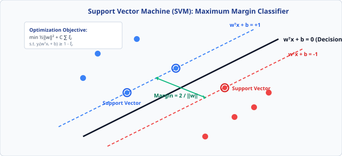

# MACSE504: Machine Learning - Module 1 | Topic 3
# Support Vector Machines (SVM): Maximum Margin, Dual Formulation & Kernel Trick
**Course:** MACSE504 Machine Learning | **Credits:** 4 | **Target:** 10-Mark VIT Examination Questions  
**Prescribed Textbooks:**  
1. L. Goel, *Artificial Intelligence: Concepts and Applications*, Wiley, 2021.  
2. Andreas Müller & Sarah Guido, *Introduction to Machine Learning with Python*, O'Reilly, 2016.  
3. T. Jo, *Machine Learning Foundations*, Springer Nature, 2021.

---

## 📺 Curated Video Lectures by Indian Professors (Under 20 Minutes)
* **CampusX (Nitish Singh) - Support Vector Machine (SVM) Geometric Intuition (19 min):** [Watch on YouTube](https://www.youtube.com/watch?v=efR1C6CvhmE)  
  *Core Focus:* Geometric margin derivation, support vectors, and hyperplane optimization.
* **Krish Naik - Hard Margin vs Soft Margin SVM & Slack Variable (16 min):** [Watch on YouTube](https://www.youtube.com/watch?v=jsfZ_Xny_sY)  
  *Core Focus:* The $C$ regularization hyperparameter and handling noisy non-separable data.
* **Gate Smashers (Varun Singla) - Kernel Trick in SVM with Examples (13 min):** [Watch on YouTube](https://www.youtube.com/watch?v=Qc5L_22gqK0)  
  *Core Focus:* Mapping into higher dimensions, Polynomial & RBF kernels.

---

## 1. Mathematical Formulation: The Maximum Margin Hyperplane

Support Vector Machines find an optimal separating hyperplane $w^T x + b = 0$ that maximizes the **Geometric Margin** between two classes.

  
  
Figure 3.1: Support Vector Machine (SVM) Maximum Margin Hyperplane with support vectors lying on the canonical margins.

### 1.1 Primal Optimization Problem (Hard-Margin SVM)
The distance from any point $x$ to the hyperplane is $\frac{|w^T x + b|}{\|w\|}$. To maximize the margin $M = \frac{2}{\|w\|}$, we minimize $\frac{1}{2} \|w\|^2$:
$$\min_{w, b} \frac{1}{2} \|w\|^2 \quad \text{subject to} \quad y_i (w^T x_i + b) \ge 1, \quad \forall i = 1, \dots, m$$

### 1.2 Soft-Margin SVM (C Hyperparameter & Slack Variables)
For non-linearly separable data, introduce slack variables $\xi_i \ge 0$:
$$\min_{w, b, \xi} \frac{1}{2} \|w\|^2 + C \sum_{i=1}^m \xi_i \quad \text{subject to} \quad y_i(w^T x_i + b) \ge 1 - \xi_i, \quad \xi_i \ge 0$$
* **Large $C$:** Strict penalty on misclassifications $\to$ narrow margin (risk of **overfitting**).
* **Small $C$:** High tolerance for misclassifications $\to$ wider margin (risk of **underfitting**).

---

## 2. The Dual Formulation & The Kernel Trick

Applying Lagrange Multipliers $\alpha_i \ge 0$ yields the **Wolfe Dual**:
$$\max_\alpha \sum_{i=1}^m \alpha_i - \frac{1}{2} \sum_{i=1}^m \sum_{j=1}^m \alpha_i \alpha_j y_i y_j (x_i \cdot x_j) \quad \text{s.t.} \quad 0 \le \alpha_i \le C, \quad \sum_{i=1}^m \alpha_i y_i = 0$$
* **Support Vectors:** Data points for which $\alpha_i > 0$. Only support vectors define $w = \sum_{i} \alpha_i y_i x_i$.

### 2.1 The Kernel Trick (Mercer's Theorem)
Replace the inner product $x_i \cdot x_j$ with a Kernel function $K(x_i, x_j) = \phi(x_i) \cdot \phi(x_j)$ without explicitly computing the high-dimensional mapping $\phi(x)$:
1. **Linear Kernel:** $K(x, z) = x^T z$
2. **Polynomial Kernel:** $K(x, z) = (x^T z + c)^d$
3. **Radial Basis Function (RBF / Gaussian Kernel):**
   $$K(x, z) = \exp(-\gamma \|x - z\|^2)$$
   *Role of $\gamma$:* High $\gamma$ creates localized, tight decision boundaries (high variance); small $\gamma$ creates smooth boundaries (high bias).

---

## 3. Model 10-Mark Solved Problems for VIT Examination

<h4>10-Mark Solved Problem 3.1: SVM Hyperplane & Support Vector Calculation</h4>
<strong>Question:</strong> Given the following 1D training points with binary labels:
 Class $+1$: $x_1 = 2, x_2 = 4$
 Class $-1$: $x_3 = 8, x_4 = 10$
 (a) Identify the Support Vectors.
 (b) Calculate the optimal weight $w$ and bias $b$ for the maximum-margin hyperplane $w \cdot x + b = 0$.
 (c) Compute the margin width $M = \frac{2}{|w|}$. (10 Marks)
  
<strong>(a) Identify Support Vectors:</strong>
The closest points between the two classes are:
- Class $+1$: $x_2 = 4$ ($y_2 = +1$)
- Class $-1$: $x_3 = 8$ ($y_3 = -1$)
These two points lie on the margin boundaries and form the **Support Vectors**.
  
<strong>(b) Calculate Weight $w$ and Bias $b$:</strong>
The canonical margin equations must be satisfied with equality at the support vectors:
1. For $x_2 = 4$: $w(4) + b = +1 \implies 4w + b = 1$
2. For $x_3 = 8$: $w(8) + b = -1 \implies 8w + b = -1$
 
Subtracting (1) from (2):
$$(8w + b) - (4w + b) = -1 - 1 \implies 4w = -2 \implies w = -\frac{1}{2} = \mathbf{-0.5}$$
Substituting $w = -0.5$ into equation (1):
$$4(-0.5) + b = 1 \implies -2 + b = 1 \implies b = \mathbf{3.0}$$
 
<strong>Hyperplane Equation:</strong> $-0.5 x + 3.0 = 0 \implies x^* = 6.0$.
(Points with $x < 6$ are classified $+1$; points with $x > 6$ are classified $-1$).
  
<strong>(c) Compute Margin Width:</strong>
$$\text{Margin } M = \frac{2}{|w|} = \frac{2}{|-0.5|} = \frac{2}{0.5} = \mathbf{4.0}$$
The physical gap between the two classes is $8 - 4 = 4.0$. The margin is maximized!

